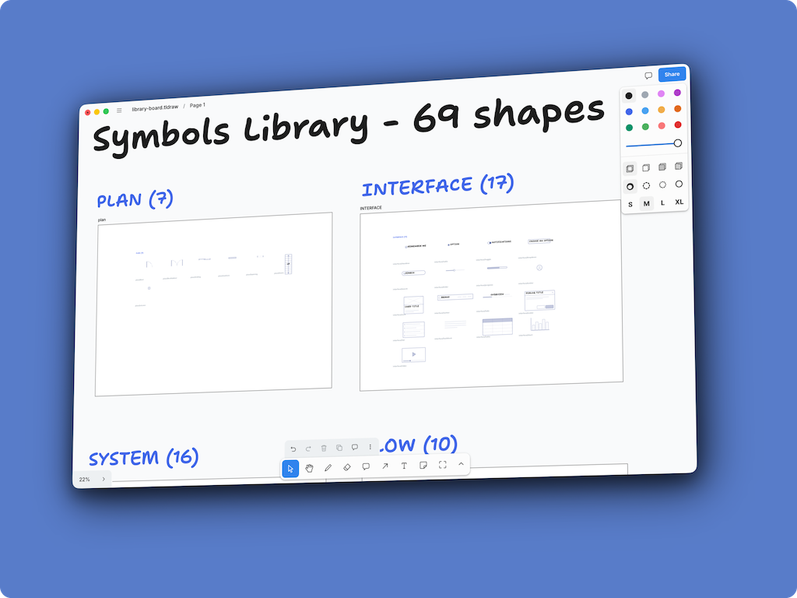

# tldraw Library — Ferroprint symbols for tldraw



Paste-ready snippet blocks for **69 diagram symbols** — floor-plan, furniture, system, flow and
interface shapes from [Ferroprint](https://github.com/bjarneo/ferroprint), converted to native tldraw
clipboard content. Works on [tldraw.com](https://tldraw.com) and in tldraw Desktop.

## How to use

1. Pick a category below.
2. Expand an element's **Copy/paste snippet** block and copy the ```html fenced content.
3. Paste into a tldraw canvas. The image (and its default label, if it has one) lands as real tldraw shapes, ready to move, resize and style.

Faster: use the library board, below — no code blocks to copy.

## Library board Usage

Do not want to manually copy-paste symbols frm readme?
Ther eis alternative way - open this file in tldraw: `library-board/library-board.tldraw`.

A ready-made tldraw document with **all 69 symbols laid out as a labelled catalog**:
[library-board/library-board.tldraw](./library-board/library-board.tldraw).
Five labelled groups (Plan, Furniture, System, Flow, Interface); each symbol sits in a grid cell with its small `category/id` name printed under it.

Step-by-step:

1. Open `library-board/library-board.tldraw` in tldraw Desktop (double-click the file, or **Open** it from tldraw offline). Leave it in its own window.
2. Find the symbol you want in the labelled grid.
3. Click it once — its whole group selects (image + its default label, if any).
4. `Ctrl/Cmd C`, switch to your drawing's window, `Ctrl/Cmd V`.
5. The symbol lands as real shapes. The label text is editable like any tldraw shape.
6. Customize color, size, etc.

Keep the board open next to your drawing and copy as you go. You cannot break the catalog — work only happens in your own board; if you change the catalog itself, save your copy under a new name.

## Categories

| Category                                   | Elements | Symbol ids                                                                                                                                                                                            |
| ------------------------------------------ | -------- | ----------------------------------------------------------------------------------------------------------------------------------------------------------------------------------------------------- |
| [Plan](./library/plan/README.md)           | 7        | `door` · `doubledoor` · `sliding` · `wallwin` · `opening` · `stairs` · `column`                                                                                                                       |
| [Furniture](./library/furniture/README.md) | 19       | `bed` · `bed2` · `sofa` · `armchair` · `chair` · `dining` · `roundtable` · `desk` · `toilet` · `sink` · `bathtub` · `shower` · `stove` · `fridge` · `counter` · `closet` · `washer` · `plant` · `car` |
| [System](./library/system/README.md)       | 16       | `server` · `cloud` · `browser` · `mobile` · `monitor` · `lock` · `function` · `container` · `globe` · `file` · `users` · `mail` · `bucket` · `firewall` · `clock` · `key`                             |
| [Flow](./library/flow/README.md)           | 10       | `data` · `fdoc` · `subproc` · `manual` · `delay` · `prep` · `manualop` · `store` · `onpage` · `offpage`                                                                                               |
| [Interface](./library/interface/README.md) | 17       | `checkbox` · `radio` · `toggle` · `dropdown` · `search` · `slider` · `progress` · `avatar` · `card` · `navbar` · `tabs` · `modal` · `list` · `textblock` · `table` · `chart` · `video`                |

Each element also has an SVG preview next to its snippet in the category pages.

## How these were generated

Everything here is generated by `scripts/build.mjs` (Ferroprint symbol sources → SVG), then
`scripts/capture-blobs.mjs` (live tldraw Desktop editor → native clipboard content) and
`scripts/emit-readmes.mjs` (this README set). See `scripts/` for the pipeline. Regeneration needs
the Ferroprint checkout next to this repo (upstream commit `e501013`, 2026-10-08) and tldraw Desktop
running.

## Provenance & style notes

- Symbols are rendered with Ferroprint's **white** theme: blue ink `#24398a` on transparent, so they sit naturally on tldraw's light canvas.
- Default labels (e.g. _Up_ on stairs) are separate editable tldraw **text** shapes grouped with the image; the symbols themselves are images (baked SVG), so strokes/labels of the drawing are not individually editable.
- Ferroprint's UML class boxes, cloud icons and templates are not included (they are dynamic in Ferroprint); connectors are not carried over — use tldraw's own connectors.

## Credits

Library shapes wer ported from awesome project at [bjarneo/ferroprint: Blueprint-style sketchpad for system diagrams, flows, wireframes and floor plans. Saves to localStorage.](https://github.com/bjarneo/ferroprint). Make sure to check it and give it a star.

## License

MIT — see [LICENSE](./LICENSE). Generated shapes derive from Ferroprint (no upstream license file at time of generation; symbol definitions © Ferroprint authors, used as the drawing source of truth).
